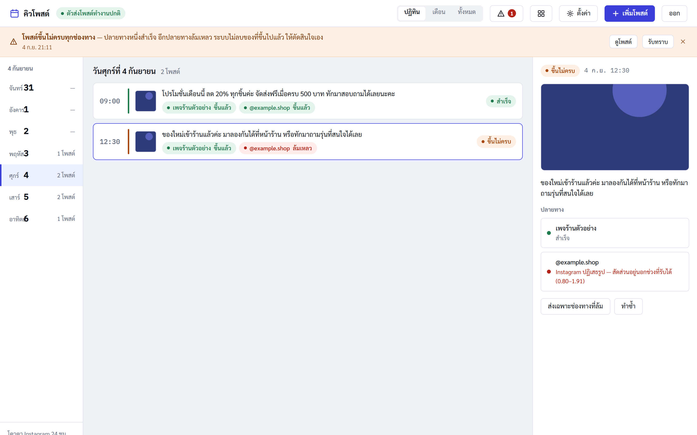

# post-scheduler

Scheduled posting to Facebook Pages and Instagram Professional accounts for small
shops — with an AI caption assistant that writes in each page's own tone, AI image
generation that never draws (mis-spelled) Thai text, platform-correct cropping, and
carousels of up to 10 images.

**Next.js · PostgreSQL · Docker · background worker**

[ภาษาไทย](README.th.md) · [Architecture](docs/architecture.md) · [Deploy](docs/deploy.md)



## Engineering highlights

| Problem | How it is handled |
|---|---|
| Two workers (or overlapping cron runs) pick the same post | Jobs are claimed with `SELECT … FOR UPDATE SKIP LOCKED` (`src/core/queue.ts`) |
| A retry posts the same thing twice | Every target carries an idempotency key; the publisher checks for an existing post before sending (`src/core/publisher.ts`) |
| Retrying errors that can never succeed | Meta errors are mapped to *retryable / permanent / credential* (`src/providers/errors.ts`); bad credentials get flagged instead of hammered |
| Page access tokens in the database | AES-256-GCM with a key version for rotation (`src/lib/crypto.ts`) |
| A dead worker cannot report that it died | The worker pings an external heartbeat URL; silence raises the alert |
| AI bill runs away | Per-tenant monthly image quota and USD cost cap, counted separately from captions |
| Image models write broken Thai | Prompts forbid text; `src/content/poster.ts` draws the text with real Thai fonts |
| A stale post fires days late | Posts that are too far past their time are not sent automatically |

**Layering:** `core/` (publishing) and `content/` (captions, images, posters) never
import each other; they meet only at the `scheduled_posts` / `post_targets` tables.
The only file that knows `graph.facebook.com` is `providers/meta/client.ts`. A new
destination is one class implementing `PublishProvider` — no change to `core/` or the UI.
The schema is multi-tenant from day one (`tenant_id` on every table) while deploying
one instance per customer.

## Run locally

```bash
node scripts/setup.mjs        # first time only: writes .env with generated secrets
docker compose up -d --build
```

Open http://localhost:3000 and sign in with `owner@example.com` / `demo1234`.
Demo data is seeded and the default provider is `mock`, so the whole pipeline runs
without a Meta app — published posts appear on `/mock-feed`.

## Tests

```bash
docker compose exec web npm run smoke        # business logic: ~190 checks against a real DB
docker compose exec web npm run check-pages  # every page actually renders the feature
```

The smoke suite covers, among others: editing / rescheduling / duplicating posts,
published posts being immutable, retries never double-posting, partial success
across FB + IG, two workers never claiming the same job, no tokens in logs, and the
AI quota stopping calls before they leave the server.

## Going live with Meta

1. `npm run verify-meta -- --token … --page …` — read-only check of what a token can actually do.
2. Onboard the page per [`docs/onboarding-runbook.md`](docs/onboarding-runbook.md); the System User token is stored encrypted.
3. Set a public `PUBLIC_BASE_URL` (Instagram only accepts public image URLs), `DEFAULT_PROVIDER=meta` and `META_APP_SECRET`.

Storage can be local disk (dev only) or any S3-compatible bucket (R2, B2, MinIO).
Notifications go to LINE via the Messaging API.

## License

Source available for review only — all rights reserved. See [LICENSE](LICENSE).
